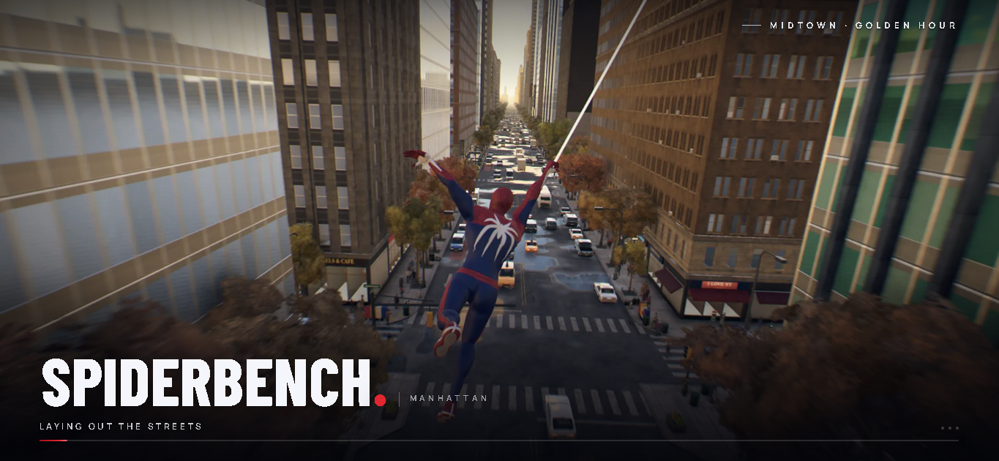

<div align="center">
  
  <br />
  <h1>Spiderbench</h1>
  <p><strong>A browser-based web-swinging game built with Three.js, Vite, Bun, and an optional Rust/WASM engine.</strong></p>

  <p>
    <a href="https://bun.sh">
      
    </a>
    <a href="https://threejs.org">
      
    </a>
    <a href="https://vite.dev">
      
    </a>
    <a href="https://www.rust-lang.org">
      
    </a>
    <a href="https://webassembly.org">
      
    </a>
    <a href="./LICENSE">
      
    </a>
  </p>
</div>

Spiderbench is a third-person web-swinging game that runs in the browser. You can swing between buildings, run on walls, perch on ledges, zip to points, and move through a large procedural city with a custom traversal and animation system.

This repository is a non-commercial fan project and technical demo meant for local development, testing, and performance experiments.

## ✨ Features

- **Web-swinging traversal:** Swinging, wall running, wall crawling, perching, zipping, diving, and other movement states driven by a custom state machine.
- **Large procedural city:** A Manhattan-style island with an authored street layout, dense buildings, rooftops, parks, bridges, traffic, and pedestrians.
- **Real-time rendering:** A Three.js WebGL2 pipeline with shadows, screen-space effects, bloom, TAA, motion blur, and multiple time-of-day presets.
- **Playable browser build:** Runs as a Vite web app and bundles for production into `dist/`.
- **Optional Rust/WASM engine:** CPU-heavy math helpers run through the Rust/WASM module in `engine/` with automatic JavaScript fallbacks if WASM is unavailable.
- **Developer tools:** Built-in help overlay and a developer menu for real-time testing and tuning.

## 🧰 Requirements

### For running and frontend development

- [Bun](https://bun.sh/) (package manager, script runner, and build commands)
- A modern browser with **WebGL2** support
- A GPU with decent WebGL performance (integrated GPUs are supported, though lower graphics settings may be needed)

### For Rust/WASM development and builds

- [Rust](https://www.rust-lang.org/tools/install) installed via `rustup`
- Rust WebAssembly target: `wasm32-unknown-unknown`
- [wasm-pack](https://drager.github.io/wasm-pack/) (compiles the Rust crate into a browser-ready WASM package)
- [mise](https://mise.jdx.dev/) (recommended; provides task shortcuts for building WASM + frontend together)

## 🚀 Getting started

### 1. Clone the repository

```bash
git clone [https://github.com/](https://github.com/)<your-username>/spiderbench.git
cd spiderbench
```

*(If you already have the project folder locally, open a terminal in the project root.)*

### 2. Install Bun

Install Bun from [bun.sh](https://bun.sh/) and verify it is available:

```bash
bun --version
```

### 3. Install Rust (for WASM builds)

Install Rust via `rustup`:

```bash
curl --proto '=https' --tlsv1.2 -sSf [https://sh.rustup.rs](https://sh.rustup.rs) | sh
```

On Windows, download the installer from [rustup.rs](https://rustup.rs/) and restart your terminal afterward.

Verify your Rust toolchain:

```bash
rustc --version
cargo --version
rustup --version
```

Add the WebAssembly compilation target:

```bash
rustup target add wasm32-unknown-unknown
```

Confirm the target is installed:

```bash
rustup target list --installed
```

### 4. Install wasm-pack

`wasm-pack` compiles the Rust crate in `engine/wasm` and outputs the browser package to `src/engine/pkg/`.

Install it with Cargo:

```bash
cargo install wasm-pack
```

Or check alternative installation methods in the [wasm-pack documentation](https://drager.github.io/wasm-pack/book/introduction.html).

Verify installation:

```bash
wasm-pack --version
```

### 5. Install mise (recommended)

`mise` executes the tasks defined in `mise.toml` so you can build WASM and start/bundle the app with a single command.

Install it following the [mise getting started guide](https://mise.jdx.dev/getting-started.html) and verify:

```bash
mise --version
```

### 6. Install frontend dependencies

From the project root:

```bash
bun install
```

## 💻 Development

### Recommended: build WASM and start the dev server

Rebuilds the WASM package and launches Vite in one step:

```bash
mise run start
```

Open in your browser:

```text
[http://127.0.0.1:5173](http://127.0.0.1:5173)
```

### Frontend-only dev server (if WASM is already built)

If `src/engine/pkg/` already exists and you haven't modified any Rust code:

```bash
bun run dev
```

Open in your browser:

```text
[http://127.0.0.1:5173](http://127.0.0.1:5173)
```

### Rebuild the Rust/WASM package during development

Whenever you edit files in `engine/core` or `engine/wasm`, regenerate the WASM bindings:

```bash
mise run wasm
```

This updates `src/engine/pkg/`. Refresh the browser (and restart the dev server if needed) to load the updated module.

## 🏗️ Build

### Full production build (recommended)

Compiles the Rust/WASM package and bundles the frontend together into `dist/`:

```bash
mise run build
```

### Frontend-only production build

If `src/engine/pkg/` is already up to date, build only the frontend into `dist/`:

```bash
bun run build
```

### WASM-only build

Compile just the Rust/WASM package into `src/engine/pkg/`:

```bash
mise run wasm
```

### Preview the production build locally

Serve the `dist/` folder locally using Vite preview (typically at `http://127.0.0.1:4173`):

```bash
bun run preview
```

Typical production build and test workflow:

```bash
mise run build
bun run preview
```

## 📜 Available scripts and tasks

### Bun scripts (`package.json`)

| Command | Description |
| :--- | :--- |
| `bun run dev` | Starts the Vite dev server on `127.0.0.1:5173` |
| `bun run build` | Builds the frontend production bundle into `dist/` |
| `bun run preview` | Serves the production build locally via Vite preview |

### mise tasks (`mise.toml`)

| Command | Description |
| :--- | :--- |
| `mise run wasm` | Builds the Rust/WASM package into `src/engine/pkg/` |
| `mise run start` | Builds WASM, then starts the Vite dev server |
| `mise run build` | Builds WASM, then creates the frontend production build |

## 🦀 Rust/WASM engine notes

- **Location:** The Rust workspace lives in `engine/` (`engine/core` for pure computation logic, `engine/wasm` for browser bindings).
- **Generated output:** `src/engine/pkg/` (generated by `wasm-pack`).
- **Runtime behavior:** The game attempts to load the WASM module at startup and falls back seamlessly to JavaScript implementations if WASM is unavailable.
- **When to rebuild:** Run `mise run wasm` (or `mise run start` / `mise run build`) after modifying any Rust source files.
- **Troubleshooting:** If WASM compilation fails, verify that `wasm32-unknown-unknown` is installed for your active Rust toolchain.

## 🎮 Controls

| Input | Action |
| :--- | :--- |
| **H** | Toggle in-game help and controls overlay |
| **`~`** (dev server) | Open developer menu |
| **`?dev` URL parameter** (production build) | Enable developer menu on a production build (when supported) |

Movement, swinging, and camera controls are documented in-game. Press **H** while playing to view the full control list.

## 📁 Project structure

| Path | Purpose |
| :--- | :--- |
| `src/` | Main game code (player, traversal, world, rendering, UI, systems) |
| `engine/` | Rust workspace for performance helpers |
| `engine/core/` | Pure Rust computation core |
| `engine/wasm/` | WASM bindings crate for browser integration |
| `src/engine/pkg/` | Generated WASM package output (build artifact) |
| `public/` | Static assets served by the app |
| `dist/` | Production build output |
| [`plan.md`](./plan.md) | Performance optimization checklist and notes |
| [`mise.toml`](./mise.toml) | Task shortcuts for WASM and app workflows |

## ⚙️ Performance tips

- Prefer a production build for performance benchmarking (`mise run build` followed by `bun run preview`).
- Lower resolution scale or graphics quality presets if your GPU is bottlenecked.
- Shadows and post-processing effects (TAA, bloom, motion blur) carry the highest GPU cost on entry-level hardware.
- On older integrated GPUs, targeting a locked **30 FPS** is more realistic than **60 FPS**.
- Initial load delays are typically caused by WebGL shader compilation and procedural city asset initialization on weaker hardware.

## 📄 License

This project is source-available and view-only. See the [LICENSE](./LICENSE) file for full terms.

This is an unofficial fan project and is not affiliated with, endorsed by, or sponsored by Marvel, Disney, Sony, or Insomniac Games. Spider-Man and all related names, characters, and likenesses are trademarks and copyrighted material of their respective owners.

## 🙏 Credits

- Bundled fonts are provided under the SIL Open Font License. See `public/assets/ui/fonts/` for font files and license details.
- In-universe references appear strictly for fan/demo context; advertised in-game brands are fictional aside from in-universe names such as the Daily Bugle and Oscorp.
